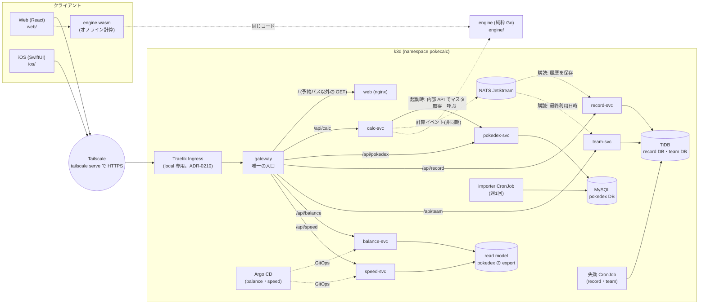
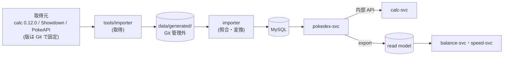

# アーキテクチャ(全体図)

ポケモンチャンピオンズ向けのダメージ計算・タイプバランス・素早さ比較・連続技・調整。計算の中心は純粋な Go の `engine` で、
サーバー(calc-svc)とブラウザ(WASM)の両方から同じコードを使う。細部は各 README、決定の理由は `docs/adr/`。
(2026-10-20 に現状のコードに合わせて更新。判定〈judge-svc〉は ADR-0715 で廃止し、機能は calc の連続技と調整の目標へ移した)

## 実行時の構成(自宅 Mac の k3d)

- 外からの到達は Tailscale だけ。公開 IP・公開ロードバランサーは作らない(ADR-0210)。
- 計算は record・team・TiDB・NATS が落ちても成功する(CLAUDE.md 絶対ルール 5)。
- gateway は上流ごとの URL(`GATEWAY_*_URL`)が未設定ならそのパスを 503 にする(calc だけ必須)。画像は `GATEWAY_IMAGES_DIR` から `/images/*` で配る(ADR-0808)。

## コンポーネント

| コンポーネント | 役割 | データ | 配備 | レーン | README |
|---|---|---|---|---|---|
| engine | ダメージ・確定数・一括計算・逆算・連続技・行動順・実数値(I/O なし) | — | calc と WASM に組み込み | データ | [engine/](../engine/README.md) |
| gateway | 入口(ルーティング・端末 ID の形式検証・CORS・画像配信) | なし | `make deploy-latest` | API | [services/gateway/](../services/gateway/README.md) |
| calc-svc | 計算 API(計算・一括・逆算・連続技 `/api/calc/combo`・調整の目標)。計算イベントを NATS へ発行 | 起動時に pokedex から取得してメモリに持つ | `make deploy-latest` | API | [services/calc/](../services/calc/README.md) |
| pokedex-svc / importer | マスタの DB・取込(calc・Showdown・PokeAPI)・公開 API・calc 向け内部 API・read model の export | MySQL(pokedex DB) | `make deploy-latest`(取込は週 1 回の CronJob) | データ | [services/pokedex/](../services/pokedex/README.md) |
| record-svc | 計算履歴・お気に入り・端末データの削除 | TiDB(record DB) | M2 のスクリプト(`make deploy-latest` から呼ぶ) | API | — |
| team-svc | 構築 CRUD(Showdown 形式の入出力) | TiDB(team DB) | 同上 | API | — |
| balance-svc | タイプバランス(analyze・coverage) | read model | Argo CD(gitops overlay) | タイプバランス | [services/balance/](../services/balance/README.md) |
| speed-svc | 素早さ比較 | read model | Argo CD の Application 定義あり | 素早さ | [services/speed/](../services/speed/README.md) |
| Web | 画面(API とオフライン WASM を切り替え)。計算(連続技を含む)・逆算・構築(タイプバランスを含む。ADR-0421)・素早さ・調整・お気に入り | ブラウザの localStorage(端末 ID など) | `make deploy-latest` | Web | [web/](../web/README.md) |
| iOS | iPhone アプリ。計算(連続技を含む)・逆算・構築(タイプバランスを含む)・素早さ・お気に入り | 端末内 | Xcode | iOS | [ios/](../ios/README.md) |
| wishlist(別アプリ) | 欲しいものリストの API・Web(PWA)・夜間の価格取得 CronJob・iOS。namespace `wishlist`、入口は `/wishlist`、MySQL は同じインスタンスの DB `wishlist`。ダメ計とは呼び合わない | MySQL(wishlist DB) | `make wishlist-k3d-deploy` | Wishlist | [apps/wishlist/](../apps/wishlist/README.md) |

## サービス内部の構造(ヘキサゴナル)

各サービスの `internal/` は `adapters/`(HTTP・DB・NATS)・`app/`(ユースケース)・`domain/`(純粋なルール)に分ける(ADR-0811。計画は [plan/architecture-adoption.md](plan/architecture-adoption.md))。
calc・gateway・pokedex・record・team・balance・speed の全サービスが移行済みで、`tools/archcheck` が形を検査する(未移行の一覧は空)。Web も依存の向きを ESLint で検査する(ADR-0811 W0〜W2)。

## データの流れ(マスタ)

- 実マスタ・スナップショットは Git に入れない(ADR-0002)。Git にあるのはコード・schema・架空データ・版の記録だけ。
- read model は、local 系の overlay では ConfigMap、gitops overlay では initContainer が pokedex の export を emptyDir に書く。
  Argo CD で同期した balance・speed が read model を持てず 503 になる件は issue #237(未解決)。
- 動作確認の手順は `docs/verify.md` と `docs/runbooks/`、進捗は `docs/plan.md`(索引)と `docs/plan/`、AI の運用は `docs/ai-shared/COORDINATION.md`。

## 配備の方法

| 対象 | 方法 |
|---|---|
| gateway・calc・pokedex・web・record・team・NATS・TiDB | 人間が `make deploy-latest`(初回は `make up`) |
| balance・speed | Argo CD(manual sync。`services/*/deploy/argocd`) |
| wishlist | `make wishlist-k3d-deploy` |
| CI | GitHub Actions(`.github/workflows/ci.yml`: gen・test・lint・build・golden・wasm・kustomize・check-publishable と Web の E2E) |

## Kustomize overlay

`deploy/k8s/base`(namespace・pokedex・calc・gateway・web・record・team・NetworkPolicy)と、balance・speed 各サービス自身の
`deploy/k8s`(base・local・local-readmodel・gitops)を、環境ごとの overlay で組み合わせる。

| overlay | 用途 |
|---|---|
| `overlays/local` | ローカル k3d(`make up`)。MySQL・NATS・TiDB・Traefik の設定を含む |
| `overlays/local-api`・`local-web`・`local-m2` | API だけ・Web だけ・M2(record・team)だけを入れ替えるときの部分 overlay |
| `overlays/cloud` | 私設サービスとして維持する前提(ADR-0209 §1・ADR-0210)。gateway の Ingress を `$patch: delete` で除去し、public Ingress・LoadBalancer・NodePort を持たない。到達は Tailscale に任せる。クラウドの構成は [plan/cloud-design.md](plan/cloud-design.md)(検討中) |

## 監視

マニフェスト(ServiceMonitor・SLO の PrometheusRule・ダッシュボード・kube-prometheus-stack / Loki / Alloy の values)は
`deploy/k8s/base/observability/` にあるが、`base` には含めず、k3d には入れていない(Docker VM の空きメモリ不足。2026-10-09 ユーザー決定)。
入れるときは `scripts/observability-bootstrap.sh` を人間が実行する(ADR-0406)。クラウド化で入れる方針(2026-10-20 ユーザー回答)。
