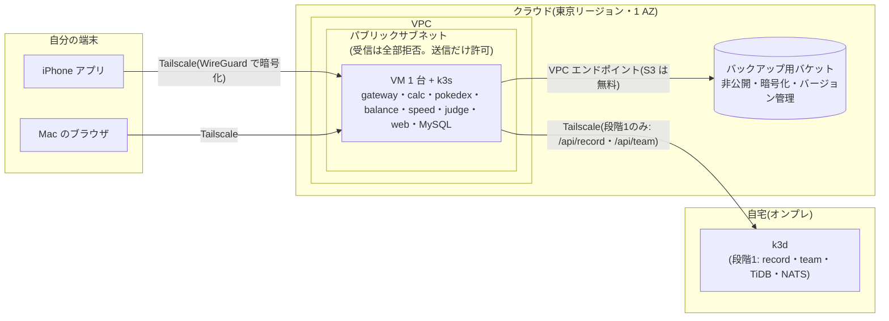

# クラウド公開の設計案(調査と選択肢。未決定)

- 状態: **案**(2026-10-11 作成。2026-10-20 に要件を追記。決定はまだ。ユーザーと一緒に §8 の質問に答えながら決め、決まったら ADR にする)
- 担当: データレーン(到達経路・運用の持ち主。COORDINATION.md)。関連 issue: #149(クラウド選定・月額上限)・#148(アクセス境界)・#103(保存データ)・#243(GitHub 設定)
- 関連 ADR: ADR-0002(実データ・画像を Git に入れない)・ADR-0209(保持・削除)・ADR-0210(私設サービスの境界)・ADR-0211(TiDB)・ADR-0212(NATS)・ADR-0225/0227(バックアップ)・ADR-0800(AI の権限ガード)・ADR-0801(過負荷時の 503)・ADR-0808/0810(画像)
- 予定 ADR 番号(運用帯 08xx。2026-10-11 に `ls docs/adr` と `git branch -r` で 0810 までの使用を確認): **ADR-0812**(クラウドの選定と段階構成)、**ADR-0813**(クラウドの費用・漏洩のガード: 予算の自動停止・AI がクラウドを操作しない仕組み)。ADR-0811 はヘキサゴナル採用が使う。決定時に番号を再確認する
- この文書の範囲: 調査・比較・設計案だけ。**クラウドのアカウント作成・リソース作成・課金が発生する操作はしていない**(CLAUDE.md「人間の確認が必要なこと」)。cloud overlay・terraform・workflows も変えていない

このリポジトリは **public**(2026-10-11 に `gh repo view` で確認)。この文書にも、今後の Terraform にも、アカウント ID・IP アドレス・tailnet 名・ドメイン名などの固有値を書かない。

---

## 0. 先に結論(推奨のたたき台)

| 項目 | 推奨 | 理由(一言) |
|---|---|---|
| 公開の形 | **非公開のまま**(Tailscale の中だけ。公開の入口〈公開 IP への受信・ロードバランサー〉を作らない) | ADR-0210 の方針どおり。AI クローラ・スキャナに見つからないのが一番安く強い |
| 常時動かす部分 | **小さな VM 1 台 + k3s**(軽量 Kubernetes)。段階 1(〜3,000円)か段階 2(〜10,000円) | NAT・ロードバランサー・管理 Kubernetes の固定費(どれも月 数千円〜1 万円)を払わずに済む |
| 本格的な構成の学習 | **使う時だけ作って、その日のうちに消す**(ラボ方式)。EKS/GKE・NAT・ALB・WAF はここで触る | 3 時間で 100〜200 円程度。常時動かすと月 2.5〜3.5 万円 |
| クラウド | **AWS を第一候補**(GCP も同じ形で作れる。§2.6 の採点) | ネットワーク部品(VPC・サブネット・NAT・ALB・WAF)を一つずつ学べる/価格が公式の価格表で確定できた/予算超過時に VM を自動停止できる |
| データベース | 段階 1 は **record・team を自宅に残す**(一時的な形)。段階 2 で **8GB の VM に TiDB ごと載せる**(**ADR-0814: 要件の技術構成で組む。MySQL へ寄せる案は採らない**) | TiKV だけで常駐約 2.2GiB(k3d 実測)。2〜4GB の VM には載らない |
| IaC | Terraform。state は専用アカウント内の暗号化バケット。**apply・destroy は人間だけ** | AI がクラウドの課金操作をしない(CLAUDE.md・ADR-0800) |
| 費用の安全装置 | 予算アラート(50/80/100%)+ **100% で VM 停止と作成禁止の自動実行**+ 異常検知 + タグで棚卸し | 「使っていないのに請求」と「キー漏洩で大量作成」の両方を止める |

各段階の月額の概算(1 ドル = 150 円で換算。**消費税 10% 込み**。詳細と出典は §3):

| 段階 | 構成の要点 | 月額の概算(税込) |
|---|---|---|
| 段階 0(〜500円) | 全部自宅(今のまま)。クラウドは予算・state・バックアップ置き場だけ | 約 0〜100 円 |
| 段階 1(〜3,000円) | VM 1 台(2GB)に計算・マスタ・Web。履歴・構築は自宅 | 約 2,000 円(Lightsail)〜3,600 円(EC2) |
| 段階 2(〜10,000円) | VM 1 台(8GB)に TiDB・NATS まで全部。または 4GB + MySQL | 約 6,500〜8,400 円 |
| 段階 3(〜30,000円) | 管理 Kubernetes(EKS)+ プライベートサブネット + NAT + 管理 DB | 約 28,000〜35,000 円(AWS)。GKE は要確認で 1.3〜2.2 万円程度 |
| ラボ(都度) | 段階 3 の構成を数時間だけ作って消す | 1 回(3 時間)約 150 円 |

---

## 1. 要件の整理

| # | 要件 | 中身 | 出典 |
|---|---|---|---|
| R1 | 非公開 | 利用者は自分だけ。公開 IP・公開ロードバランサーを作らない。端末 ID は認証ではない(推測・なりすましを防げない) | requirements.md §1・ADR-0210・ADR-0209 §2 |
| R2 | 作りやすく・載せやすく | Terraform 1 回で作れる。既存の Kustomize(k8s の設定を環境ごとに重ねる仕組み)と OCI イメージ(コンテナの標準形式)をそのまま載せる | 2026-10-11 ユーザー回答・#149 |
| R3 | 削除しやすく・撤退しやすく | `terraform destroy` で全部消える。消し忘れで課金が続かない。データは手元へ書き出せる | 同上 |
| R4 | 学習 | VPC・サブネット・NAT・ALB・WAF・IAM・Kubernetes を順に学ぶ。構成はユーザーと一緒に決める | requirements.md §1-2・同上 |
| R5 | 予算の段階 | 〜3,000円/〜10,000円/〜30,000円の段階ごとに「何が動くか・何を諦めるか・いくらか」 | 同上 |
| R6 | オンプレ併用 | 自宅の Mac(k3d)とクラウドを組み合わせてよい | 同上 |
| R7 | AI 時代の漏洩・不正利用・高額請求(denial of wallet。他人に資源を使わせて請求を膨らませる攻撃)の対策 | クローラ・スキャナ、キー漏洩、誤公開、プロンプトインジェクション(AI への指示を外部の文章に紛れ込ませる攻撃)、自動停止 | 同上 |
| R8 | 第三者データ | ポケモン公式画像・実マスタは個人利用。公開しない・再配布しない | ADR-0002・ADR-0810 |
| R9 | 計算は止めない | record・team・TiDB・NATS が無くても計算 API は成功する | CLAUDE.md 絶対ルール 5 |
| R10 | アプリにクラウド固有の SDK を入れない | 固有の部分は deploy/ と Terraform に閉じる | #149 受け入れ条件 |

### 1.1 載せるもの(現状の実装)

| 部品 | 状態を持つか | メモリの目安 | 備考 |
|---|---|---|---|
| gateway・calc・pokedex・balance・speed・judge・web(nginx) | 持たない | 各 10〜20MB(実測。request は 10m CPU・16Mi) | ステートレス。どこでも動く |
| record・team | 持たない(DB に置く) | 各 10〜20MB | TiDB(record DB・team DB)を使う |
| MySQL(pokedex DB) | 持つ | 数百 MB(要実測) | マスタ。週 1 回の import CronJob |
| TiDB(PD・TiKV・TiDB 各 1 台) | 持つ | **TiKV だけで約 2.2GiB 常駐**(k3d 実測。limit 3Gi) | ADR-0211・ADR-0226 |
| NATS JetStream | 持つ(未処理イベント) | 小さい(要実測) | 計算イベントの非同期保存(ADR-0212)。`CALC_NATS_URL` が空なら発行しない |
| Argo CD | 持たない | 数百 MB(要実測) | GitOps は balance だけ |
| 監視(kube-prometheus-stack・Loki) | 持つ | 1GB 以上(要実測) | k3d では空きメモリ不足で入れていない(2026-10-09 ユーザー決定) |
| ポケモン画像 | ファイル | — | gateway が `GATEWAY_IMAGES_DIR` から `/images/*` で配信(ADR-0808)。Git 管理外 |

k3d の Docker には 8GB(実質約 7.75GiB)を割り当てていて余裕が小さい。**全部をクラウドに載せるなら 8GB 級の VM が要る**。これが段階の分かれ目になる。

---

## 2. 構成の選択肢と比較

### 2.1 比較の基準

全候補を次の 5 つで見る(◎ 良い/○ 普通/△ 弱い/× 不向き)。月額は §3 の数字を使う。

| 基準 | 見ること |
|---|---|
| 月額 | 常時動かしたときの固定費。使わない時間に止められるか |
| 運用の手間 | OS 更新・証明書・バックアップ・障害対応を自分でやる量 |
| 学習価値 | VPC・NAT・ALB・IAM・Kubernetes をどれだけ触れるか |
| 撤退しやすさ | `terraform destroy` で消し切れるか。残りやすい物があるか |
| セキュリティ | 公開面の小ささ、権限の分けやすさ |

### 2.2 実行基盤(コンテナを動かす場所)

| 候補 | 一言説明 | 月額(常時) | 手間 | 学習 | 撤退 | セキュリティ | このアプリとの相性 |
|---|---|---|---|---|---|---|---|
| **単一 VM + k3s**(EC2 / Compute Engine) | 仮想マシン 1 台に軽量 Kubernetes を入れる。今の k3d とほぼ同じ | ◎ 2GB で約 2,400〜3,600円、8GB で約 8,000〜12,000円 | △ OS 更新は自分 | ○ VPC・SG・IAM は触れる。k8s はそのまま | ◎ VM とディスクを消すだけ | ◎ 受信ポートを全部閉じて Tailscale だけにできる | ◎ Kustomize・Argo CD・TiDB Operator がそのまま動く |
| Lightsail(AWS) | VM・ディスク・転送量・公開 IPv4 がセットの定額 VM | ◎ 2GB $12・4GB $24・8GB $44 | △ 同上 | △ VPC は隠れていて学べない | ◎ | ○ ファイアウォールはある | ◎ k3s を入れれば同じ |
| ECS Fargate(AWS) | サーバー管理なしでコンテナを動かす AWS 独自の仕組み | △ 1 タスク(0.25vCPU・0.5GB)で約 $9。8 サービスで約 $72 | ○ | ○ AWS 固有(タスク定義・Service Connect) | ○ | ○ | △ Kustomize が使えず定義を作り直し。TiDB(状態あり)は載せにくい |
| EKS(AWS) | AWS の管理 Kubernetes | × 管理料だけで $73(約 11,000円)+ ノード | ○ | ◎ 本番の定番構成を学べる | ○ ロードバランサー・ENI・ボリュームが残りやすい | ○ | ◎ |
| App Runner(AWS) | URL を持つコンテナ実行の簡易版 | ○ | ◎ | △ | ◎ | △ 公開 URL が前提(非公開にするには VPC 接続が要る) | △ サービス数ぶん作る |
| Cloud Run(GCP) | リクエストが来た時だけ動くコンテナ実行。無料枠が大きい | ◎ 個人利用なら無料枠内の見込み | ◎ | ○ | ◎ | △ 既定で公開 URL。非公開化は IAM 認証・IAP(Google ログインで守る仕組み)・内部 LB が要る | △ サービス間の内部 API・NATS・TiDB と組み合わせにくい。iOS から IAP 越しは難しい |
| GKE Autopilot(GCP) | Pod の request 分だけ払う管理 Kubernetes。管理料は月 $74.40 の無料クレジットで 1 クラスタ分が相殺 | ○ 要確認(Pod 単価と最小 request への切り上げ次第) | ◎ ノード管理なし | ◎ | ○ | ○ | ○ 10m/16Mi の request は最小値へ切り上げられる(#149) |
| GKE Standard(zonal) | ノードを自分で選ぶ管理 Kubernetes。管理料はクレジットで相殺 | ○ ノード代のみ(要確認) | ○ | ◎ | ○ | ○ | ◎ |
| **自宅(オンプレ)+ Tailscale** | 今の k3d をそのまま使う | ◎ 0 円(電気代のみ) | ○ Mac が寝ると止まる | △ クラウドは学べない | ◎ | ◎ 今の方式 | ◎ |

### 2.3 データベース

> **決定(2026-10-21, ADR-0814)**: クラウドも要件の技術構成(TiDB・NATS・k8s・Argo CD・監視)で組む。下の表の **A を既定**とし、B・G は採らない。C・D・E は「同じ技術の運用負担を減らす」場合にのみ検討する。費用が上限を超えるため、上限の見直しか使う時だけ起動する運用かをユーザーが決める(§8)。

record・team が TiDB を使うのは、要件で「NewSQL を学ぶ」ため(requirements.md §5)で、性能の必要からではない。コードは MySQL 互換のプロトコルと sqlc で書かれていて、TiDB 固有の構文(`AUTO_RANDOM` 等)は record・team のコードに見当たらない(2026-10-11 に grep。**MySQL で動くかは実際に migrate とテストで要検証**)。

| 候補 | 月額 | 何が嬉しい | 何を諦める | 撤退 |
|---|---|---|---|---|
| A. TiDB クラスタをそのまま(VM 内) | VM が 8GB 級になる差額(約 +4,000〜7,000円) | k3d と同じ。NewSQL の学習を続けられる | メモリ。VM が大きくなる | VM と一緒に消える。先に `make db-backup` |
| B. MySQL 1 台に寄せる(pokedex の MySQL に record・team の DB とユーザーを足す) | ほぼ 0(4GB VM で足りる見込み) | 軽い。バックアップが 1 系統 | TiDB の学習。**requirements.md §5 と ADR-0211 の変更(新 ADR)が要る**。「自分の DB にだけ触る」(絶対ルール 4)は DB とユーザーを分けて守る | 同上 |
| C. マネージド MySQL(RDS db.t4g.micro / Cloud SQL db-f1-micro) | RDS 約 $21(約 3,500円 税込)/ Cloud SQL 約 $8〜10 + ディスク(東京の単価は要確認) | 自動バックアップ・パッチ | 費用。DB の中身の学習は減る | スナップショットが残りやすい(削除時の最終スナップショット設定に注意) |
| D. Aurora Serverless v2(MySQL 互換) | 0.5 ACU 常時で約 $55。自動一時停止(0 ACU)を使えば下がる(**対応バージョン・再開の待ち時間は要確認**) | 使わない時は安い | 起動待ち。設定が多い | 同上 |
| E. TiDB Cloud Starter(PingCAP の管理 TiDB) | 無料枠: 1 インスタンスあたり行ストレージ 5GiB・5,000 万 RU/月(RU は処理量の単位)。組織あたり無料 5 インスタンス | TiDB を運用せずに使える | データが第三者の基盤に出る。**接続口がインターネット公開**(TLS + パスワード)なので漏洩時に直接読まれる。東京リージョンの有無・支出上限の設定は要確認 | コンソールで削除 |
| F. record・team を自宅に残す | 0 | クラウドの DB が要らない。段階 1 で使える | Mac が寝ている間は履歴・構築が使えない(計算は動く: 絶対ルール 5) | 何もしない |
| G. SQLite | 0 | 最軽量 | sqlc・migrate・テストの作り直し(技術規約の変更)。推奨しない | — |

### 2.4 メッセージ(NATS JetStream)

| 候補 | 評価 |
|---|---|
| **VM/クラスタ内の NATS(今の StatefulSet)** | 推奨。小さく、コードを変えない |
| SQS/SNS・Pub/Sub などクラウドのキュー | アプリにクラウド固有 SDK が入る(R10 に反する)。推奨しない |
| 置かない | record を自宅に残す段階 1 では、クラウド側の calc は `CALC_NATS_URL` を空にしてイベントを発行しない(計算は動く)。履歴の自動保存はクラウド経由の計算では残らない |

### 2.5 画像配信

| 候補 | 評価 |
|---|---|
| **gateway がディスクから配る(今の方式。ADR-0808)** | 推奨。VM のディスクに置き、Tailscale の中だけで見える。撤退時は VM と一緒に消える |
| S3 + CloudFront / GCS + CDN | 公開の配信網に第三者の画像を置くことになる。署名付き URL や Access で守れるが手間に見合わない。**推奨しない** |
| 置かない | 画像は必須ではない(タイプ色のエンブレムで成立)。一番安全 |

**画像をクラウドに置くときの注意**(ADR-0002・ADR-0810。法的な評価ではなく運用上の約束):

1. 公開バケット・CDN・公開レジストリに置かない。**コンテナイメージに焼き込まない**(このリポジトリは public で、GHCR 等のパッケージの公開設定を誤ると一緒に公開される)。
2. 置く場所は VM のディスク(暗号化)だけ。バックアップのバケットに含めない(手元で `make assets-fetch` から作り直せる)。
3. 撤退時はディスクごと消す。スナップショットにも残る点に注意する。
4. 実マスタ(DB の中身)も同じ扱い。DB のバックアップは非公開・暗号化のバケットだけ。

### 2.6 ネットワーク(非公開の入口と、クラウド内の通り道)

#### 用語(初出の一言説明)

- **VPC**: クラウドの中に作る自分専用のネットワーク。**サブネット**はその中の区画。
- **パブリックサブネット**: インターネットへの出入口(インターネットゲートウェイ)への経路がある区画。**プライベートサブネット**: その経路が無い区画。
- **NAT ゲートウェイ**: プライベートサブネットの機械が外へ**出る**ためだけの出口(外からは入れない)。AWS では時間課金が高い。
- **ALB**: HTTP のロードバランサー。**WAF**: ALB 等の前で悪いリクエストを落とすフィルタ。
- **エグレス**: クラウドから外へ出る通信。量に応じて課金される。
- **SG(セキュリティグループ)/ファイアウォール**: 機械ごとの通信の許可リスト。
- **VPC エンドポイント / Private Google Access**: インターネットを通らずに S3・GCS 等へ行く専用の道。

#### 推奨の最小構成(段階 1・2)



- **公開の受信口がゼロ**: SG の受信ルールは空。Tailscale は外向きの通信だけで繋がる(UDP の直接接続が無理なら中継サーバー経由)。
- **NAT を置かない**: VM はパブリックサブネットに置き、送信用に公開 IPv4 を 1 つ持つ($0.005/時 = 月 約 550円)。受信を全部拒否するので、プライベートサブネット + NAT と同じ「外から入れない」状態を、NAT の固定費(東京 約 $45/月)なしで作る。
- **管理の入口も公開しない**: SSH のポートを開けない。AWS は Systems Manager の Session Manager、GCP は IAP の TCP 転送(または Tailscale SSH)で入る。
- IPv6 だけにすると公開 IPv4 の課金が消えるが、GHCR 等のイメージ取得先が IPv6 に対応していない場合に取れなくなる(**要確認**)。最初は IPv4 で始める。

#### 非公開アクセスの方式の比較

| 方式 | 月額 | 公開面 | iOS アプリから | 学習 | 評価 |
|---|---|---|---|---|---|
| **Tailscale**(今の方式) | 無料(Personal: 6 ユーザーまで・端末数無制限・ACL グループ 3 つまで) | なし(tailnet の中だけ) | ◎ 公式アプリ。今と同じ | ○ WireGuard・ACL | **推奨**。ADR-0210 と連続。Funnel(公開機能)は使わない |
| Cloudflare Tunnel + Access | 無料(Zero Trust Free は 50 ユーザーまで)。独自ドメインが要る(年 千〜数千円・要確認) | 公開のホスト名ができ、Access のログイン画面までは誰でも届く | △ ブラウザは OK。ネイティブアプリはサービストークンか WARP クライアントが要る | ○ ゼロトラスト | 次点。ブラウザだけで使うなら便利 |
| ALB + Cognito(+ WAF) | ALB 約 $24 + WAF $5〜 | 公開 ALB(スキャナに必ず見つかる) | △ トークン処理が要る | ◎ ALB・WAF・OIDC | ラボで学ぶ用。常設は非推奨 |
| AWS Client VPN | 接続先の関連付けが時間課金で高い(**要確認**。月 1 万円以上の見込み) | なし | ○ | ○ | 非推奨(費用) |
| 自前 WireGuard | 0 | UDP ポートを 1 つ公開 | ○ | ◎ | 鍵管理を自分でやる。Tailscale で足りる |
| IP アドレス許可 | 0 | 公開(許可外は拒否) | × 携帯回線の IP は変わる | △ | 非推奨 |
| GCP IAP | LB 経由なら LB 代。Cloud Run 直結の IAP は要確認 | 公開(Google ログインで守る) | × ネイティブアプリは難しい | ○ | GCP でブラウザだけなら候補 |

#### 段階 3・ラボで学ぶネットワーク(本番らしい形)

パブリックサブネット(ALB・NAT)+ プライベートサブネット(ノード・DB)+ NAT ゲートウェイ + S3 のゲートウェイ型エンドポイント(無料)+ ECR のインターフェース型エンドポイント(1 個 1 AZ で約 $10/月)。この形は「なぜ NAT が要るのか」「なぜ NAT 代が高いのか」「エンドポイントで NAT を通らない道を作ると何が安くなるか」を学ぶのに向く。常設すると NAT だけで月 約 7,500 円(税込)かかるので、ラボで作って消す。

### 2.7 AWS と GCP の採点

| 基準 | AWS | GCP |
|---|---|---|
| 月額(小さな VM 常設) | ○ EC2 t4g.small 約 $16、Lightsail 2GB $12。公式の価格表で確定 | ○ e2 系の東京価格は**要確認**。無料の e2-micro は米国リージョンだけ(1GB で k3s には小さい) |
| 月額(管理 Kubernetes 常設) | × EKS 管理料 $73 + NAT $45 | ◎ 管理料は月 $74.40 のクレジットで 1 クラスタ相殺。Cloud NAT は 1 台なら約 $1 + IP 代 + $0.045/GB |
| 運用の手間 | ○ | ○(Autopilot は ◎) |
| 学習価値(ネットワーク) | ◎ VPC・サブネット・ルート表・NAT・ALB・WAF を一つずつ作る | ○ 抽象化が多い(サブネットはリージョン単位・ファイアウォールは VPC 単位) |
| 撤退しやすさ | ○ 専用アカウントを作れば最後はアカウントごと閉じられる(閉鎖後の猶予期間あり) | ◎ **プロジェクト削除で中身を丸ごと止めて消せる** |
| 費用の自動停止 | ○ AWS Budgets のアクションで EC2・RDS の停止と IAM/SCP の拒否を自動実行(NAT・ALB・EKS は止まらない) | ○ 予算通知 → Pub/Sub → 関数でプロジェクトの課金を無効化(公式手順。**リソースが消える恐れ**) |
| セキュリティの部品 | ◎ Organizations・SCP・IAM Identity Center・Access Analyzer | ○ IAM・組織ポリシー(個人アカウントでは組織が無く使えない物がある) |

**たたき台**: 常設は AWS の小さな VM(段階 1・2)。管理 Kubernetes はラボで EKS を触り、常設したくなったら GKE を再比較する。#149 の既定案(GCP 第一候補)は「管理 Kubernetes を常設する」前提だった。今回のユーザーの意向(ネットワーク部品の学習・段階ごとの予算・撤退しやすさ)では、常設は VM、管理 Kubernetes はラボ、が合う。**どちらにするかは §8 Q2 で決める**。

---

## 3. 予算の段階ごとの構成と概算費用

### 3.1 前提

- 為替: **1 ドル = 150 円**(仮置き。実勢は要確認)。表の円は税抜、右端の「税込」は消費税 10% を足した額。
- 1 か月 = 730 時間。リージョンは東京(AWS ap-northeast-1 / GCP asia-northeast1)。
- 利用は自分 1 人。エグレス(外への転送)は月 数 GB(AWS はアカウント全体で月 100GB まで無料の枠があるため 0 円で見積る。**枠の条件は要確認**)。
- 無料利用枠・クレジットは除いて見積る(新規アカウントの特典は期限付きのため)。
- 価格の確認日: **2026-10-11**。AWS は公式の Price List API(価格表の機械可読版)で東京の単価を取得、GCP は公式の価格ページ。

### 3.2 単価(出典)

| サービス | 単価(東京) | 出典 |
|---|---|---|
| EC2 t4g.nano / micro / small / medium / large | $0.0054 / $0.0108 / $0.0216 / $0.0432 / $0.0864 毎時 | https://aws.amazon.com/ec2/pricing/on-demand/(Price List: AmazonEC2 ap-northeast-1) |
| EBS gp3 | $0.096 /GB・月 | https://aws.amazon.com/ebs/pricing/ |
| 公開 IPv4 | $0.005 /時(使用中も未使用も) | https://aws.amazon.com/vpc/pricing/(Price List: AmazonVPC ap-northeast-1) |
| VPC インターフェース型エンドポイント | $0.014 /時・個・AZ + $0.01/GB | 同上 |
| NAT ゲートウェイ | $0.062 /時 + $0.062 /GB(**要確認**: 公式ページは東京の値を表示せず、第三者の集計で確認。公式の料金計算ツールで再確認する) | https://aws.amazon.com/vpc/pricing/ |
| ALB | $0.0243 /時 + $0.008 /LCU 時 | https://aws.amazon.com/elasticloadbalancing/pricing/(Price List: AWSELB) |
| EKS | $0.10 /時・クラスタ(延長サポート中は $0.60) | https://aws.amazon.com/eks/pricing/ |
| Fargate(ARM) | $0.04045 /vCPU 時 + $0.00442 /GB 時 | https://aws.amazon.com/fargate/pricing/(Price List: AmazonECS) |
| RDS MySQL db.t4g.micro / small(Single-AZ) | $0.025 / $0.05 毎時。gp3 ストレージ $0.138 /GB・月 | https://aws.amazon.com/rds/mysql/pricing/(Price List: AmazonRDS) |
| Aurora Serverless v2(MySQL) | $0.15 /ACU 時 | https://aws.amazon.com/rds/aurora/pricing/ |
| Lightsail(IPv4 付き) | 2GB $12・4GB $24・8GB $44 /月(IPv6 のみなら $10・$20・$40) | https://aws.amazon.com/lightsail/pricing/ |
| WAF | Web ACL $5 /月 + リクエスト $0.60 /100 万件 + ルール代(**要確認**) | https://aws.amazon.com/waf/pricing/ |
| Secrets Manager | $0.40 /シークレット・月 | https://aws.amazon.com/secrets-manager/pricing/ |
| CloudWatch Logs | 取り込み $0.76 /GB、保存 $0.033 /GB・月。アラーム $0.10 /個 | https://aws.amazon.com/cloudwatch/pricing/ |
| S3 Standard | $0.025 /GB・月 | https://aws.amazon.com/s3/pricing/ |
| ECR | $0.10 /GB・月 | https://aws.amazon.com/ecr/pricing/ |
| データ転送(外へ) | $0.114 /GB(最初の 10TB) | https://aws.amazon.com/ec2/pricing/on-demand/(Price List: AWSDataTransfer) |
| AWS Budgets | 予算は無料。アクション付き予算は 2 個まで無料、以降 $0.10 /日 | https://aws.amazon.com/aws-cost-management/aws-budgets/pricing/ |
| GKE | 管理料 $0.10 /時・クラスタ。月 $74.40 の無料クレジット(請求アカウントごと。Autopilot か zonal Standard の 1 クラスタ相当)。Autopilot の Pod 単価は**要確認** | https://cloud.google.com/kubernetes-engine/pricing |
| Cloud Run(東京は Tier 1) | リクエスト課金: CPU $0.000024 /vCPU 秒・メモリ $0.0000025 /GiB 秒。無料枠 月 18 万 vCPU 秒・36 万 GiB 秒・200 万リクエスト | https://cloud.google.com/run/pricing |
| Cloud SQL(MySQL) | db-f1-micro $0.0105 /時・db-g1-small $0.035 /時、SSD $0.000232877 /GiB 時(約 $0.17 /GB・月)。**ページの表示地域が東京か要確認** | https://cloud.google.com/sql/pricing |
| Cloud NAT | $0.0014 × 使う VM 数 /時(32 台まで)+ $0.045 /GiB + IP $0.005 /時 | https://cloud.google.com/nat/pricing |
| Compute Engine | e2 系の東京単価は**要確認**。無料の e2-micro は us-west1・us-central1・us-east1 だけ(30GB 標準ディスク) | https://cloud.google.com/products/compute/pricing ・ https://cloud.google.com/free/docs/free-cloud-features |
| Tailscale | Personal 無料(6 ユーザー・端末無制限) | https://tailscale.com/pricing |
| Cloudflare Zero Trust | 50 ユーザーまで無料、以降 $7 /人・月 | https://www.cloudflare.com/plans/zero-trust-services/ |
| TiDB Cloud Starter | 無料枠: 行ストレージ 5GiB・列ストレージ 5GiB・5,000 万 RU /月(インスタンスごと) | https://docs.pingcap.com/tidbcloud/select-cluster-tier/ |

### 3.3 段階 0(〜500円): 全部自宅 + クラウドは安全装置だけ

| 項目 | 中身 |
|---|---|
| 動くもの | 今の k3d 全部(自宅)。外出先からは Tailscale(今のまま) |
| クラウドに作るもの | 専用アカウント、予算アラート、Terraform の state バケット、暗号化したバックアップのバケット(`make db-backup` の書き出しを置く) |
| 諦めるもの | Mac が寝ると使えない。クラウドの実行基盤の学習 |
| 月額 | S3 1GB 程度で **約 5 円**。予算・IAM は無料。**税込 0〜100 円** |
| 学べること | アカウント分離・MFA・IAM・予算・Terraform の state と destroy |

### 3.4 段階 1(〜3,000円): 小さな VM 1 台に計算とマスタ

| 項目 | 中身 |
|---|---|
| 動くもの(クラウド) | VM(2GB)+ k3s: gateway・calc・pokedex・balance・speed・judge・web・MySQL・画像。Tailscale で到達 |
| 動くもの(自宅) | record・team・TiDB・NATS(gateway から Tailscale 経由で呼ぶ。または使わない) |
| 諦めるもの | Mac が寝ている間の履歴・構築(計算は動く)。Argo CD・監視は載せない(メモリ。要実測) |
| 構成の選択肢 | 1a: Lightsail 2GB / 1b: EC2 t4g.small(VPC を自分で作る) |

| 内訳 | 1a Lightsail 2GB | 1b EC2 t4g.small |
|---|---|---|
| 計算 | $12.00(IPv4・60GB SSD・転送 3TB 込み) | $15.77 |
| DB | VM 内 MySQL($0) | VM 内 MySQL($0) |
| ネットワーク(NAT・ALB・エグレス) | $0(NAT・ALB なし) | 公開 IPv4 $3.65。NAT・ALB なし。エグレスは無料枠内 |
| ストレージ | 含む。スナップショット 数十円(要確認) | gp3 20GB $1.92 + S3 バックアップ 5GB $0.13 |
| 監視 | 予算アラート $0、CloudWatch アラーム 2 個 $0.20 | 同左 |
| **合計** | **約 $12.2 → 約 1,830円(税込 約 2,000円)** | **約 $21.7 → 約 3,250円(税込 約 3,580円)** |
| 夜間 8 時間停止 | 定額のため変わらない | 計算が 2/3 で約 $16.4 → 税込 約 2,700円 |

1b は「VPC・サブネット・ルート表・SG・IAM ロールを自分で作る」学習が付く。1a は安いが VPC が隠れる。

### 3.5 段階 2(〜10,000円): VM 1 台に全部(TiDB・NATS まで)

| 項目 | 中身 |
|---|---|
| 動くもの | k3d と同じ全部(record・team・TiDB・NATS・Argo CD)。監視は軽いもの(要実測) |
| 諦めるもの | 冗長性(VM 1 台・1 AZ)。管理 Kubernetes の学習 |

| 内訳 | 2a EC2 t4g.large 8GB(TiDB そのまま) | 2b Lightsail 8GB(TiDB そのまま) | 2c EC2 t4g.medium 4GB + MySQL に寄せる |
|---|---|---|---|
| 計算 | $63.07(夜間 8 時間停止で $42.05) | $44.00 | $31.54 |
| DB | VM 内 TiDB + MySQL | 同左 | VM 内 MySQL のみ(要 ADR) |
| ネットワーク | 公開 IPv4 $3.65 | 含む | 公開 IPv4 $3.65 |
| ストレージ | gp3 40GB $3.84 + S3 $0.5 | 含む + スナップショット(要確認) | gp3 30GB $2.88 + S3 $0.5 |
| 監視 | $0.5 | $0.5 | $0.5 |
| **合計** | **常時 約 $71.6 → 税込 約 11,800円**(超過)/ **夜間停止 約 $50.5 → 税込 約 8,300円** | **約 $46 → 税込 約 7,600円** | **約 $39 → 税込 約 6,500円** |

GCP で同じ形(e2-standard-2 8GB 等)にする場合、東京の VM 単価が要確認のため **税込 約 9,000〜12,000円の幅**で見ておく。GKE Autopilot に全部載せる案は、Pod の最小 request への切り上げと TiKV の 2〜3GB request で **税込 約 9,000〜22,000円(要確認)**。

### 3.6 段階 3(〜30,000円): 管理 Kubernetes + プライベートサブネット(本番らしい形)

| 内訳 | 3a EKS(AWS) | 3b ECS Fargate(AWS) | 3c GKE Standard zonal(GCP) |
|---|---|---|---|
| 計算 | EKS $73.00 + ノード t4g.medium×2 $63.07 | 8 タスク × 0.25vCPU/0.5GB $72(TiDB は載せず MySQL へ) | 管理料はクレジットで $0。ノード 2 台(要確認 約 $50〜70) |
| DB | RDS db.t4g.micro + 20GB $21.0(pokedex)。TiDB はノード内 | RDS db.t4g.micro $21.0(record・team も) | Cloud SQL db-f1-micro 約 $10(要確認)+ TiDB はノード内 |
| ネットワーク | NAT GW $45.26 + IPv4 $3.65 + 処理 10GB $0.62。ALB なし(Tailscale Operator) | NAT GW 約 $49.5 + 内部 ALB 約 $24 | Cloud NAT 約 $5 + 処理 |
| ストレージ | EBS 2×20GB $3.84、ECR 2GB $0.2 | ECR $0.2 | PD 要確認、Artifact Registry 0.5GB 無料 |
| 監視 | CloudWatch Logs 2GB $1.6 + Secrets 3 個 $1.2 | 同左 | Cloud Logging 無料枠内の見込み(要確認) |
| **合計(税込)** | **約 $213 → 約 35,000円**(超過)。NAT GW を NAT インスタンス(t4g.nano)に替えると 約 $172 → **約 28,400円** | **約 $170 → 約 28,000円** | **約 1.3〜2.2 万円(要確認)** |

段階 3 を**常設する理由は薄い**(利用者 1 人で冗長性が要らない)。同じ構成を **ラボ方式**で学ぶのが推奨:

| ラボ(3 時間で作って消す) | 費用 |
|---|---|
| EKS $0.30 + ノード 2 台 $0.26 + NAT $0.19 + ALB $0.07 + IPv4 等 | 約 $0.85 → **約 140円(税込)/回** |
| 消し忘れて 1 日放置 | 約 $7 → 約 1,100円/日(予算アラートと TTL タグで防ぐ。§5) |

---

## 4. セキュリティ設計(AI 時代の漏洩・不正利用・高額請求)

### 4.1 脅威ごとの対策

| # | 脅威 | 対策 | 費用 | 入れる段階 |
|---|---|---|---|---|
| S1 | AI 系クローラ・スキャナによる公開エンドポイントの発見(IPv4 全域の走査、証明書透明性ログ〈発行された証明書の公開台帳〉からのホスト名収集) | 公開の受信口を作らない(SG 受信ゼロ・LB なし)。Tailscale の HTTPS 証明書でも tailnet 名は台帳に載るが、外から到達はできない。Cloudflare Access を使う場合は公開ホスト名が見つかる前提で、ログイン必須にする | 0 | 全段階 |
| S2 | 大量アクセスによる高額請求(denial of wallet) | 到達できない(S1)ことが第一。アプリ側は ADR-0801 の同時実行上限と 503。Cloud Run/Fargate を使う場合は最大インスタンス数を 1〜2 に固定。公開 LB を作るラボでは WAF のレート制限ルール | 0(WAF は $5〜/月) | 全段階(WAF はラボ) |
| S3 | 認証情報(アクセスキー・トークン)の漏洩: リポジトリ(**public**)・ログ・AI ツールの文脈経由 | **長期のアクセスキーを作らない**(IAM Identity Center の一時認証 `aws sso login` / `gcloud auth login`)。CI から使うなら OIDC(GitHub の一時トークンで一時ロールを受け取る仕組み)。`make check-publishable` に加えて GitHub の secret scanning と push protection(public リポジトリは無料)。AI エージェントには認証情報ファイル(AWS・gcloud の設定フォルダ・`*.tfstate`・`*.tfvars`)を読ませない(設定は人間の PR) | 0 | 段階 0 から |
| S4 | 盗まれたキーでの大量作成(暗号資産の採掘で GPU を大量起動など) | SCP(組織で使える操作を制限する仕組み)で東京と us-east-1(グローバル系)以外のリージョンを禁止、GPU・大きなインスタンスの作成を禁止。サービスクォータ(作れる上限)を小さく保つ。予算アクションで作成禁止の IAM ポリシーを自動適用 | 0 | 段階 0 から |
| S5 | 公開バケット・管理画面(Argo CD・Grafana・TiDB Dashboard)の誤公開 | S3 はアカウント単位の「パブリックアクセスのブロック」を有効化、GCS は公開アクセス防止。管理画面は port-forward か tailnet の中だけ。IAM Access Analyzer(外部から触れるリソースの検出。外部アクセス分析は無料)で定期確認 | 0 | 段階 0 から |
| S6 | プロンプトインジェクション経由の操作(issue・PR コメント・Web ページに紛れた指示で、AI が `terraform apply/destroy`・`aws`・`gcloud` を実行する) | AI にクラウドの認証情報を渡さない(実行できない状態にする)。bash-guard(ADR-0800)に `aws`・`gcloud`・`terraform`/`tofu` の apply・destroy・import・state 操作を「人間の確認」として追加(人間がマージする PR。ADR-0812 予定)。apply は人間が自分の端末で実行 | 0 | 段階 0 から |
| S7 | 消し忘れ・想定外の従量課金(NAT の処理量・ログの取り込み・スナップショット) | タグ必須 + 週 1 回の棚卸し(§5.3)。ログの保持期間 7〜14 日、取り込み量のアラーム。予算アラート + 異常検知(AWS Cost Anomaly Detection は無料) | 0 | 段階 0 から |
| S8 | Tailscale アカウントの乗っ取り・端末紛失 | ログイン元(Apple/Google 等)に MFA。ACL でクラウドの VM へ届く端末をタグで限定(ADR-0210 §7)。紛失時は端末を tailnet から外す。VM 参加用の auth key は使い捨て(ephemeral)・期限付き・タグ付き | 0 | 段階 1 から |
| S9 | ログの機微情報 | gateway のログに認証情報は無い(認証が無い)。端末 ID は秘密ではないが(ADR-0209 §2)、計算内容・構築はクラウドのログ基盤へ送らない/送るなら保持を短く。Tailscale の auth key・DB パスワードを環境変数のダンプでログへ出さない | 0 | 段階 1 から |
| S10 | Terraform state の漏洩(state には生成したパスワード等が平文で入る) | state は専用アカウントの非公開・暗号化・バージョン管理付きバケット。Git に入れない(`.gitignore` と check-publishable で検査)。DB パスワードは Terraform で作らず、Secrets Manager/Secret Manager に人間が入れる案も検討 | 数円 | 段階 0 から |
| S11 | サプライチェーン(イメージ・依存) | イメージは digest 固定(ADR-0405 の方式)。レジストリは非公開。Dependabot alerts(#243 で有効化済み) | ECR $0.10/GB | 段階 1 から |
| S12 | 第三者データの再配布 | §2.5 の約束。公開バケット・公開イメージに入れない | 0 | 全段階 |

### 4.2 請求の自動停止(予算 + 自動アクション)

注意: どちらのクラウドも**予算は上限ではない**。請求データの反映に数時間〜1 日程度の遅れがあり(**要確認**)、その間の課金は止められない。だから「予算 < 本当の上限」に設定し、そもそも高い固定費の部品を常設しない(§3)。

**AWS 案**

| 閾値(例: 月 3,000 円相当を USD で設定) | 動作 |
|---|---|
| 実績 50% | メール通知 |
| 実績 80% / 予測 100% | メール通知(+ スマホの通知) |
| 実績 100% | **予算アクション(自動実行)**: ① 運用ロールに「EC2・RDS・EKS・NAT・ELB の作成を禁止する IAM ポリシー」を付ける ② 指定した EC2・RDS を停止する(アクションは 2 個まで無料) |
| 実績 100%(止まらない物) | SNS → Lambda で、タグ `Ephemeral=true` の NAT ゲートウェイ・ALB・EKS ノードグループを消す(**作るかはラボ開始前に決める**。誤って常設物を消さないようタグで限定) |
| 常時 | Cost Anomaly Detection(普段と違う増え方を検知。無料) |

- Organizations を使うと、SCP の付け替えでアカウントごと「新規作成を禁止」にできる(管理アカウントからメンバーアカウントへ)。
- 予算アクションは「自動実行」か「承認後に実行」を選べる。推奨は自動実行(深夜に気付けないため)。

**GCP 案**

| 閾値 | 動作 |
|---|---|
| 50% / 80% / 100% | メール通知 |
| 100% | 予算の通知を Pub/Sub(メッセージの配送)へ送り、Cloud Run functions でプロジェクトの課金を無効化(公式手順)。**全リソースが止まり、消える恐れがある**。データは自宅にバックアップがある前提で使う。代わりに「VM だけ止める」関数にする選択もある |
| 常時 | プロジェクトの Compute Engine クォータ(CPU 数)を小さく設定 |

### 4.3 アカウント・権限

| 項目 | AWS | GCP |
|---|---|---|
| 分離 | Organizations で**専用のメンバーアカウント**を作る(管理アカウントは請求だけ。ワークロードを置かない) | **専用プロジェクト**を作る(個人 Gmail では組織が無いため、組織ポリシーは使えない物がある) |
| ルート/管理者 | ルートユーザーに MFA、アクセスキーは作らない。日常は IAM Identity Center のユーザー(MFA 必須) | Google アカウントに 2 段階認証(パスキー推奨) |
| 権限の分け方 | `admin`(人間・apply 用)/ `readonly`(棚卸し・plan 用)/ VM のインスタンスロール(S3 のバックアップ用バケットへの書き込みだけ) | 同様にロールを分ける。VM のサービスアカウントは GCS の 1 バケットだけ |
| AI エージェント | **権限を渡さない**(当面)。将来渡すとしても `readonly` だけ・人間の承認後 | 同左 |

### 4.4 シークレット管理

| 秘密 | 置き場 | 備考 |
|---|---|---|
| DB パスワード(MySQL・TiDB・record/team の app/migrator) | クラスタ内 Secret(今と同じ)。元は Secrets Manager/Secret Manager か、人間の手元のパスワード管理 | Git に置かない(既存方針)。Secrets Manager は 1 個 $0.40/月(SSM Parameter Store の標準は無料) |
| Tailscale の auth key | 使い捨て・期限付き。VM 起動時に 1 回だけ使う | cloud-init のユーザーデータに平文で残さない(残すならすぐ失効させる) |
| kubeconfig | 人間の Mac だけ。tailnet 経由で API サーバーへ | AI に読ませない |
| Terraform state | §4.1 S10 | |

---

## 5. 撤退しやすさ

### 5.1 Terraform の構成(案)

作る場所の案: `infra/terraform/`(新規。**この PR では作らない**。決定後、人間がマージする PR で作る)。

```
infra/terraform/
  aws/
    00-bootstrap/   state バケット(初回はローカル state → 移行)・予算・予算アクション・IAM ロール・SCP・Access Analyzer
    10-network/     VPC・サブネット・ルート表・SG・S3 ゲートウェイ型エンドポイント(enable_nat = false が既定)
    20-compute/     VM(cloud-init で k3s と Tailscale)・インスタンスロール・EBS
    30-data/        バックアップ用バケット(バージョン管理・暗号化・ライフサイクル)。マネージド DB は count = 0 が既定
    labs/eks/       ラボ用。全リソースに Ephemeral=true と Expires タグ
  gcp/              同じ分け方
```

| 決めごと | 中身 |
|---|---|
| 分割の理由 | 壊す範囲を小さくする。`20-compute` だけ消して作り直す、ができる |
| state の置き場 | 専用アカウントの S3(Terraform 1.10 以降の S3 ネイティブロック `use_lockfile` で DynamoDB 不要。要確認)/ GCS。非公開・暗号化・バージョン管理 |
| 版の固定 | `required_version` と provider を厳密に固定(最新安定版。ユーザー方針)。`.terraform.lock.hcl` はコミットしてよい(秘密を含まない) |
| Git に入れない物 | `*.tfstate*`・`*.tfvars`(固有値)・`.terraform/`。例は `example.tfvars` に架空値で |
| タグ(ラベル) | provider の `default_tags`(GCP は `default_labels`)で全リソースに `Project=pokecalc`・`Env`・`ManagedBy=terraform`・`Owner`・`Expires=YYYY-MM-DD`(ラボのみ)・`Ephemeral=true/false` |
| 消せなくなる設定を避ける | `prevent_destroy` は付けない(撤退の妨げ)。代わりにバックアップ用バケットだけ `force_destroy = false`(中身を書き出す前に消さない) |

### 5.2 消す手順(撤退)

1. データを書き出す: record・team・pokedex を `make db-backup`(ADR-0225。論理バックアップ = mysqldump の SQL)で手元へ。復元訓練(`make db-restore-drill-k3d` 相当)で読めることを確認。
2. `terraform destroy` を逆順に: `labs/*` → `20-compute` → `30-data`(バケットを空にしてから)→ `10-network` → `00-bootstrap`(最後。state バケットを空にして消す)。
3. Tailscale の管理画面から VM のノードを外す。auth key を失効。
4. 棚卸し(§5.3)で 0 件を確認。翌日・翌月の請求で 0 円を確認。
5. 完全撤退: AWS は専用メンバーアカウントを閉じる、GCP はプロジェクトを削除(猶予期間中に復元もできる)。

### 5.3 消し忘れの防止(タグ + 棚卸し)

| 方法 | AWS | GCP |
|---|---|---|
| タグ付きリソースの一覧 | Resource Groups Tagging API / Resource Explorer で `Project=pokecalc` を一覧 | Cloud Asset Inventory でプロジェクト内を一覧 |
| タグの無い物を拾う | 請求のサービス別内訳(Cost Explorer)で 0 円でないサービスを確認 | 請求レポートのサービス別 |
| 残りやすい物 | EBS スナップショット・未使用の公開 IPv4・CloudWatch ロググループ・ECR のイメージ・S3 の古いバージョン・KMS キー(削除待ちの間も課金)・ENI・RDS の最終スナップショット | 永続ディスク・スナップショット・静的 IP・Artifact Registry のイメージ |
| 期限 | ラボは `Expires` タグ。予定時刻に通知(EventBridge Scheduler 等)。自動削除は §4.2 の Lambda に限定 | 同様 |
| 頻度 | 週 1 回(人間)。`readonly` ロールでの一覧取得は将来 AI に任せてもよい(§8 Q9) | 同左 |

### 5.4 段階的に載せる順序(各段階で止められる)

| 順 | やること | ここで止めたら残る物 | 月額 |
|---|---|---|---|
| 1 | 専用アカウント・MFA・予算・SCP・state バケット(`00-bootstrap`) | 安全装置だけ | 約 0 円 |
| 2 | VPC だけ作って消す練習(`10-network`)。NAT を一瞬だけ付けて請求の動きを見る | 何も残さない | 数十円 |
| 3 | VM 1 台 + k3s + Tailscale。stateless サービスだけ(段階 1。マスタは架空データで動作確認) | VM 1 台 | 約 2,000〜3,600円 |
| 4 | MySQL に実マスタ(人間が投入)。画像(任意) | 同上 | 同上 |
| 5 | record・team の扱いを決めて載せる(段階 2) | VM 1 台(8GB) | 約 6,500〜8,400円 |
| 6 | ラボで EKS/GKE・NAT・ALB・WAF を作って消す | 何も残さない | 1 回 約 140円 |

---

## 6. 既存リポジトリとの接続

| 既存の物 | 今の状態 | クラウド化での扱い(案) |
|---|---|---|
| `deploy/k8s/overlays/cloud` | 雛形。gateway の Ingress を削除・import と失効の CronJob を停止(DB・Secret が無いため) | #149 の方針どおり、**クラウド・形態ごとの overlay を新しく作る**(例: `overlays/cloud-vm`。k3s on VM 用)。既存の base・local は変えない。cloud overlay の変更は人間がマージする PR |
| Ingress | base は host なし・HTTP の local 専用(Traefik) | VM 上でも公開しない。到達は VM 上の `tailscale serve`(今の Mac と同じ形)か Tailscale Kubernetes Operator(要検証) |
| 画像 | local overlay だけ hostPath(ADR-0808) | VM のディスクを同じく hostPath(読み取り専用)。base は変えない |
| Argo CD | balance だけ GitOps。リポジトリは public なので取得に認証は不要(非公開に戻すなら PAT が要る。PENDING) | VM 上にも入れられる(メモリ要実測)。damage calc 系は今の `make deploy-latest` 相当を tailnet 越しに人間が実行 |
| レジストリ | ローカルレジストリ(k3d)と digest 固定 | ECR / Artifact Registry / GHCR の**非公開**。画像・実マスタをイメージに入れない(既存方針の確認) |
| バックアップ | `make db-backup`・復元訓練(ADR-0225・0227)。クラウドの保存先は未実施 | 保存先を暗号化バケットに(VM のインスタンスロールで書き込みだけ) |
| CI(`.github/workflows/ci.yml`) | クラウドの認証情報なし | 当面そのまま。将来 `terraform fmt -check`・`validate` だけ追加(認証不要)。plan を CI で回すなら OIDC の `readonly` ロール。**apply は CI でも AI でも行わない**。workflows の変更は人間がマージ |
| AI のガード(ADR-0800 bash-guard・`.claude/settings.json`) | `aws`・`gcloud`・`terraform` を検査していない(2026-10-11 確認) | ADR-0812(予定)で、クラウドの変更系コマンドを「人間の確認」に追加し、認証情報ファイルの読み取りを拒否。**この変更は人間がマージする** |
| 公開前検査(`make check-publishable`) | 固有値・秘密の検査 | `*.tfstate`・`*.tfvars`・アカウント ID 形式の検出を足す案(別 PR) |

### 6.1 人間だけが行う操作(human-only)

- クラウドのアカウント・プロジェクトの作成、請求先(クレジットカード)の登録、MFA の設定
- `terraform apply` / `destroy` / `import` / `state` 操作、コンソールでの作成・削除
- 予算・予算アクション・SCP の作成と変更
- Tailscale の auth key の発行・ノードの承認・ACL の変更
- 実マスタ・画像のクラウドへの投入、DB のデータ削除
- 秘密値(DB パスワード・kubeconfig)の作成と保管
- cloud overlay・terraform・workflows・ガード(`.claude/`・`scripts/ai-guard/`)を変える PR のマージ
- ドメインの購入(Cloudflare を選ぶ場合)

---

## 7. 学習の進め方(一緒に考える順序)

| 回 | テーマ | やること | 成果物 | 費用 |
|---|---|---|---|---|
| ① | ネットワークの最小構成を図で | §2.6 の図をたたき台に、「どこから入れて、どこへ出すか」をユーザーと描き直す。NAT・ALB が要る場面と要らない場面を言葉にする | 図(この文書を更新) | 0 |
| ② | 費用の確認 | 公式の料金計算ツールに §3 の構成を入れ、要確認の単価(NAT・GCP の VM・Autopilot)を埋める | §3 の更新 | 0 |
| ③ | 安全装置から作る | 専用アカウント・MFA・予算アラート・予算アクション・SCP を Terraform で(`00-bootstrap`) | Terraform(人間がマージ) | 約 0 円 |
| ④ | 作って消す練習 | VPC だけを `apply` → コンソールで確認 → `destroy`。次に NAT を 1 時間だけ付けて請求の反映を観察 | 手順書 | 数十円 |
| ⑤ | VM 1 台に載せる | 段階 1。Tailscale で iPhone から計算。止めて・消して・作り直す時間を測る | overlay・runbook | 約 2,000〜3,600円/月 |
| ⑥ | データを決める | record・team を自宅に残すか、TiDB ごと載せるか、MySQL に寄せるか(§8 Q3) | ADR | 段階による |
| ⑦ | ラボ | EKS(または GKE)+ プライベートサブネット + NAT + ALB + WAF を 3 時間で作って消す | ラボ手順書 | 1 回 約 140円 |

---

## 8. 未決の質問(ユーザーに答えてほしいこと)

**ユーザーの回答(2026-10-11)**
- Q1: 常設は急がない。**作って壊すを繰り返す(ラボ中心)**。管理 Kubernetes は **EKS と GKE の両方、ECS も**試したい。安くても動作が快適でないのは避けたい。常設したくなったら、そのときに載せる(=推奨の (a) 段階 0 に近く、ラボの対象に ECS・EKS・GKE を入れる)。
- Q2: **AWS を先に**(GKE は後のラボで比較する)。
- Q4: **Tailscale**。
- Q5: **上限 3,000 円で開始**(50%・80% で通知、100% で VM 停止と新規作成の禁止を自動実行)。
- Q3: **要件の技術構成で組む(2026-10-21, ADR-0814)**。クラウドも TiDB・NATS・k8s・Argo CD・監視で組み、MySQL へ寄せる案は採らない。言語(Go・TypeScript/React・Swift)は変えない。
  - 費用の目安: 8GB の VM(EC2 t4g.large)は 1 時間 約 11 円。**使う時だけ起動する(ラボ中心の運用)**なら、月 100 時間でも 約 1,100〜1,500 円で、上限 3,000 円に収まる。常時起動(月 約 7,600〜11,800 円)は上限を超える。→ 常時にするか、起動時間で収めるかが残りの判断。
- Q6〜Q9 は未回答(推奨のまま進めてよいが、決定時に再確認する)。

**ユーザーの回答(2026-10-20。`docs/ai-shared/decisions/2026-10-20-cloud-requirements.md`)**
- クラウド化の目的は **Mac が寝ていても動くこと**。構成案は予算 3 段階(最安・月 3,000 円・理想形ラボ)× AWS / GCP / マルチクラウドで比べる。
- Q3 の方向: **TiDB は使う・使わないを切り替えられる**ようにし、DB は**クラウドのマネージドサービス**を使う方向(段階ごとの費用は未決)。
- CD: **Terraform(インフラ)+ Argo CD(アプリ)**。クラウドでは `make deploy-latest` の手動配備を使わない。
- 併せて直す: issue #237(Argo CD 管理の balance・speed の 503)、監視の導入、calc の起動順依存、単一障害点(gateway 1 台など)。


各質問は「推奨」を先頭に置く。記号で答えれば足りる形にしている。

**Q1. 常に動かすのはどこまでか**
- **推奨: (b)** 段階 1〜2 の VM 1 台を常設し、管理 Kubernetes・NAT・ALB はラボ(作って消す)で学ぶ
- (a) 段階 0: 常設はしない(今の自宅 + Tailscale のまま)。クラウドはラボだけ
- (c) 段階 3 を常設する(月 2.8〜3.5 万円)

**Q2. クラウドはどちらから始めるか**
- **推奨: (a) AWS**(ネットワーク部品を一つずつ学べる・小さな VM の価格が確定・予算アクションで VM を止められる)
- (b) GCP(プロジェクト削除で撤退が簡単・GKE の管理料クレジット・Cloud Run の無料枠。東京の VM 単価は要確認)
- (c) 両方(ラボで同じ構成を作って比較してから常設を決める。学習は増えるが管理するアカウントも 2 倍)

**Q3. record・team(TiDB)をクラウドでどうするか**
- **決定(ADR-0814): (a)。段階 1 の間だけ (d)。(b) は採らない**
- (a) TiDB ごと 8GB の VM に載せる(k3d と同じ。月 約 6,500〜8,400 円)
- (b) MySQL 1 台に寄せる(4GB で足りる。requirements.md と ADR-0211 の変更が要る。TiDB の学習は終わる)
- (c) TiDB Cloud Starter(無料枠。接続口が公開でデータが第三者の基盤に出る)
- (d) 自宅に残す(クラウドの gateway から Tailscale 越しに呼ぶ。Mac が寝ると履歴・構築は使えない)

**Q4. 非公開の入口の方式**
- **推奨: (a) Tailscale**(今と同じ。iOS アプリがそのまま使える・費用 0・公開面 0)
- (b) Cloudflare Tunnel + Access(ブラウザだけなら便利。ドメインが要る。公開ホスト名ができる)
- (c) ALB + 認証(学習用。常設しない)

**Q5. 月額の上限と、超えたときの止め方**
- **推奨: 上限 3,000 円で開始。50%・80% で通知、100% で「VM 停止 + 新規作成の禁止」を自動実行**
- (a) 通知だけ(自分で止める)
- (b) 上の推奨
- (c) 課金そのものを止める(GCP のプロジェクト課金の無効化 / AWS は全リソースの削除。データが消える恐れ)
- 上限額: 3,000 / 10,000 / 30,000 / その他(金額)

**Q6. アカウントの分け方**
- **推奨: (a)** 新しく専用のアカウント(AWS は Organizations のメンバーアカウント / GCP は専用プロジェクト)を作る
- (b) 既存のアカウントに同居させる(タグで分ける。撤退時に消し漏れやすい)

**Q7. Terraform の state の置き場**
- **推奨: (a)** 専用アカウント内の暗号化・バージョン管理付きバケット(`00-bootstrap` で作る)
- (b) 手元の Mac のファイル(最も簡単。紛失・Mac 故障で管理不能になる)
- (c) HCP Terraform(外部サービス。無料枠の条件は要確認)

**Q8. ポケモン画像をクラウドに置くか**
- **推奨: (a)** 置かない(エンブレム表示で使う)。置くなら VM のディスクだけ・バックアップしない・撤退時に消す
- (b) VM のディスクに置く(上の約束を守る)
- (c) バケットや CDN に置く(**非推奨**。誤公開の影響が大きい)

**Q9. AI エージェントにクラウドの権限を渡すか**
- **推奨: (a)** 渡さない。Terraform の作成・plan・apply は人間。AI は文書と Terraform のコード(PR)まで
- (b) 読み取り専用ロールだけ渡す(棚卸し・plan を AI に任せる。プロンプトインジェクション時の情報漏洩の面は増える)
- (c) 作成もさせる(**非推奨**。CLAUDE.md の人間の確認事項に反する)

**Q10. リージョン**
- **推奨: (a)** 東京(遅延が小さい。価格は米国より 2〜4 割高い)
- (b) 大阪(災害の分散の学習。価格・サービスの揃いは要確認)
- (c) 米国(GCP の無料 e2-micro が使える。遅延 100ms 前後。1GB で k3s には小さい)

---

## 付記: 再計算の手順(価格は変わるため固定値に頼らない)

1. AWS: Price List API の地域別ファイル(例 `https://pricing.us-east-1.amazonaws.com/offers/v1.0/aws/<サービス>/current/ap-northeast-1/index.json`)か、公式の料金計算ツール(https://calculator.aws/)に §3 の構成を入れる。
2. GCP: 公式の料金計算ツール(https://cloud.google.com/products/calculator)に同じ構成を入れる。「要確認」の行(GCE e2 の東京単価・Autopilot の Pod 単価と最小 request・Cloud SQL の東京単価・NAT の東京単価)を優先して埋める。
3. 為替・消費税・無料枠の条件を更新し、この文書の確認日を書き換える。
